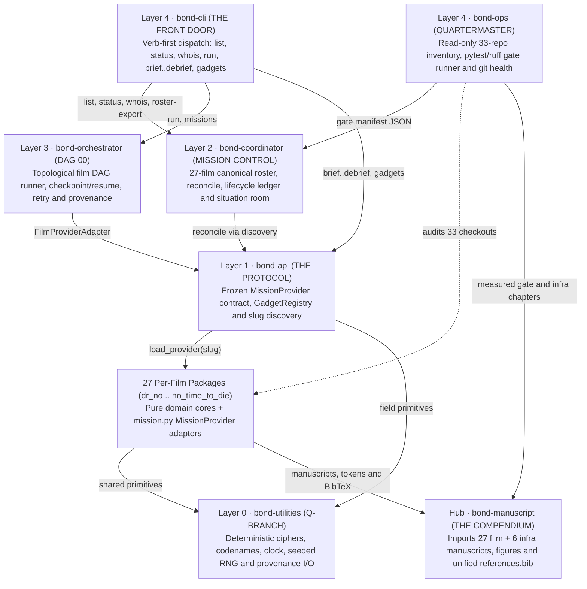

# bond-manuscript — the PROJECT BOND compendium

The **top-level wrapper manuscript** for the 33-package BOND suite. This is the
manuscript the template renders: one chapter imported from each package's own
manuscript, framed by an introduction and a closing, with a **unified
bibliography** merged from every package's `references.bib`.

<p align="center"></p>

**Codename:** THE COMPENDIUM · **Rendered PDF:** `output/pdf/bond-manuscript_combined.pdf`

## System architecture



**Source map:** [`compendium.py`](src/bond_manuscript/compendium.py), [`manuscript_variables.py`](src/bond_manuscript/manuscript_variables.py), [`02_suite_architecture.md`](docs/manuscript/02_suite_architecture.md), [`generate_compendium.py`](scripts/generate_compendium.py).

## Public release

The public source repository is https://github.com/docxology/bond. The v1.0.0
release is available at https://github.com/docxology/bond/releases/tag/v1.0.0.
The archival Zenodo record is https://doi.org/10.5281/zenodo.21843802; the
concept DOI is https://doi.org/10.5281/zenodo.21843592. The PDF attached to the
release carries the concept DOI so it remains stable across Zenodo versions.

## What it is

| Piece | Origin |
| --- | --- |
| `00_abstract.md` · `01_introduction.md` · `90_closing.md` | hand-written wrapper prose (tokens injected) |
| `02_suite_architecture.md` | generated — layered topology + roster + measured gate |
| `03_01_…` … `03_27_…` | **generated film chapters** — one per Bond film, the package's **full manuscript** imported (abstract + every authored section + figures) |
| `04_01_…` … `04_06_…` | **generated infrastructure chapters** (utilities, api, coordinator, orchestrator, cli, ops) |
| `99_references.md` · `references.bib` | generated — the **unified bibliography** merged from all 33 packages |

Each package chapter reproduces that package's **complete manuscript**, not an
abstract-only excerpt: the abstract and every authored section (introduction,
methodology, results, conclusion, experimental setup, reproducibility, scope)
are imported token-hydrated from the package's own `manuscript_variables.json`,
its figures are carried into the combined PDF, its mission codename/objectives
are read from its live `MissionProvider`, and its references are merged into
the unified `references.bib` (both real BibTeX and plain-numbered lists are
handled and de-duplicated by key).

## Regenerate + render

```bash
# 1. Regenerate the compendium (33 chapters + unified bibliography)
uv run python scripts/generate_compendium.py

# 2. Hydrate {{TOKEN}}s into output/manuscript/
uv run python scripts/z_generate_manuscript_variables.py

# 3. Render the wrapper PDF via the template pipeline (from the repo root)
uv run python scripts/pipeline/stage_03_render.py --project working/bond/bond-manuscript
```

`generate_compendium.py` is deterministic: re-running it produces byte-identical
sections and bibliography (test-locked).

## Layout

```
src/bond_manuscript/   compendium.py (discovery, abstract import, bib merge, sections)
                       manuscript_variables.py ({{TOKEN}} map from live discovery)
scripts/               generate_compendium.py · z_generate_manuscript_variables.py
docs/manuscript/            the wrapper manuscript (sections + unified references.bib)
tests/                 43 tests, no mocks, ≥90% coverage on src/
```

The 33 source packages this compendium imports from live outside this
repository: `scripts/generate_compendium.py` resolves the suite root from
`--bond-root` (default `../..`) and needs those sibling checkouts to regenerate
the chapters. The published tree carries the wrapper plus its generated sections.
