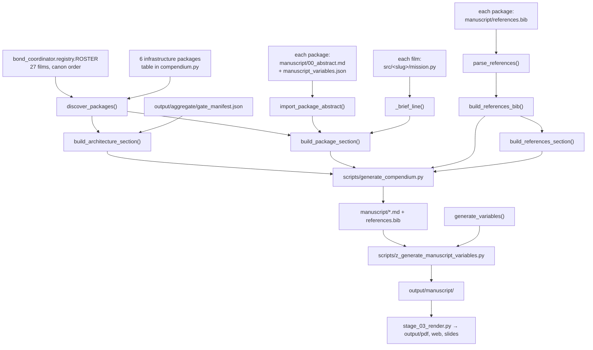

# Architecture

`bond-manuscript` is a wrapper: it assembles a single top-level manuscript out of
the 33 PROJECT BOND package manuscripts. It owns no research content of its own.
Understanding which layer owns which fact prevents the two mistakes this project
is prone to — hand-authoring a fact that should have been imported, and putting
fleet logic in a script where no test can reach it.

## Layers

| Layer | Files | Owns | Must not |
| --- | --- | --- | --- |
| **`src/bond_manuscript/`** — pure core | `compendium.py`, `manuscript_variables.py` | Discovery, abstract import, token resolution, bibliography merge, section text | Write files; import `infrastructure.*`; import suite packages at module scope |
| **`scripts/`** — orchestrators | `generate_compendium.py`, `z_generate_manuscript_variables.py` | Where output goes, exit codes, `sys.path` setup | Parse packages, assemble chapters, or hold any fleet knowledge |
| **`manuscript/`** — content | Hand-authored boundaries + generated chapters | The wrapper's own prose; the generated sections as build output | Be hand-edited where generated |
| **The fleet** — inputs | 33 sibling package trees | Every fact about a film or an infrastructure package | — |

## Dependency direction

```
scripts/       ──→ bond_manuscript                 (the package under src/)
scripts/       ──→ infrastructure.rendering        (hydration only)
compendium.py  ──→ bond_coordinator.registry       (lazy, inside the function)
compendium.py  ──→ bond_api.discovery              (lazy, inside the function)
compendium.py  ──→ [stdlib only, otherwise]
tests/         ──→ the package, the generator (by subprocess), the real fleet
```

Nothing points upward. `compendium.py` imports no template infrastructure at all,
which is what lets the test suite run against the fleet without the monorepo
pipeline installed.

## Data flow



## Suite dependencies

`pyproject.toml` declares `bond-api`, `bond-coordinator`, and `bond-utilities` as
local path dependencies, plus `scipy` — the last one only because
`die_another_day`'s provider imports it, and the compendium loads every film's
provider to build the chapter brief line. A package that adds a dependency its
provider needs must have it resolvable here too, or that chapter loses content and
`generate_compendium.py` exits 1.

## Forbidden patterns

| Pattern | Why | Instead |
| --- | --- | --- |
| Hand-writing a film's facts into a package chapter | The chapter is generated; the edit is deleted on the next run | Edit that package's `manuscript/00_abstract.md` |
| Adding an entry to `manuscript/references.bib` | The file is a merge output | Add it to the source package's `references.bib` and re-run |
| Fleet parsing in `scripts/` | Untestable without running the whole build | Move it to `compendium.py` and cover it |
| `from infrastructure import …` in `src/` | Breaks the core's independence from the monorepo | Call infrastructure from `scripts/` |
| `except Exception: return ""` around a content-producing call | Silently drops chapter content | Record the failure (`BRIEF_FAILURES`) and let the caller report it |
| A blanket glob unlink in the manuscript directory | Deletes hand-authored boundaries | Match generated filenames by explicit pattern |
| Anything order-dependent on `set` or `glob` | Breaks byte-stable regeneration | Roster order and `OrderedDict` |

## Adding a generated section

1. Add the builder to `compendium.py` as a pure function returning a string.
2. Export it from `bond_manuscript/__init__.py`.
3. Add a test in `tests/test_compendium.py` asserting the section's observable
   structure against real fleet data.
4. Add the write in `scripts/generate_compendium.py`, and add its filename to the
   `_GENERATED_*` patterns so the next run replaces rather than duplicates it.
5. Re-run the generator twice and confirm byte-identical output.

## See also

- [`../src/AGENTS.md`](../src/AGENTS.md) — the API and its invariants
- [`../scripts/AGENTS.md`](../scripts/AGENTS.md) — what each orchestrator writes
- [`rendering_pipeline.md`](rendering_pipeline.md) — generate → hydrate → render
- [`testing_philosophy.md`](testing_philosophy.md) — why the core is pure
